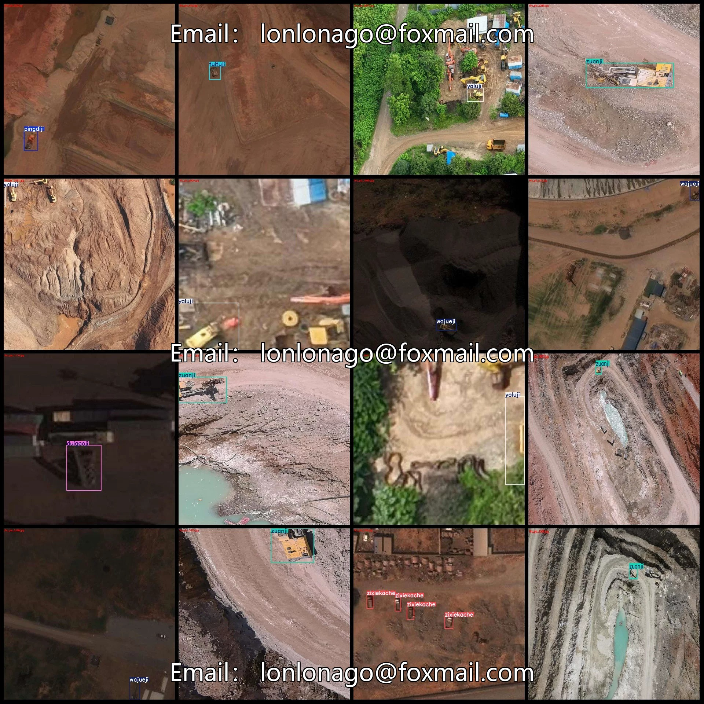
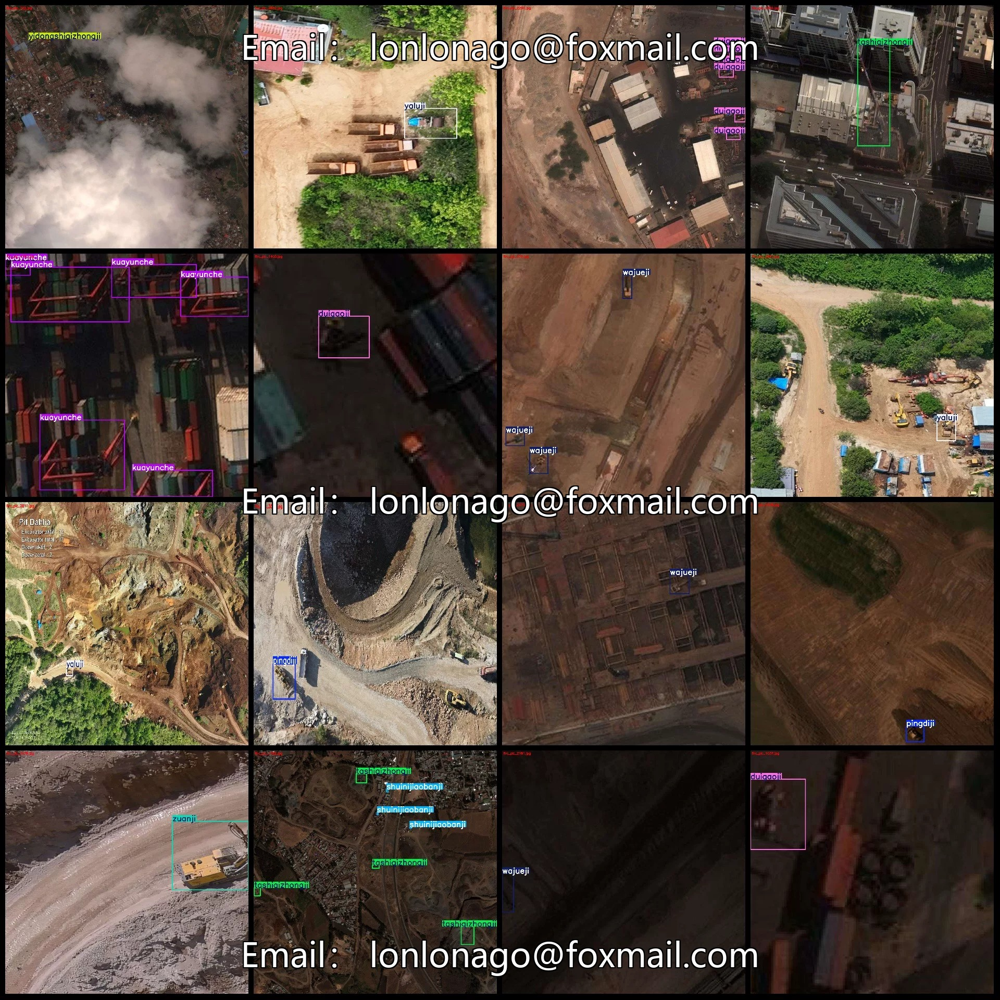
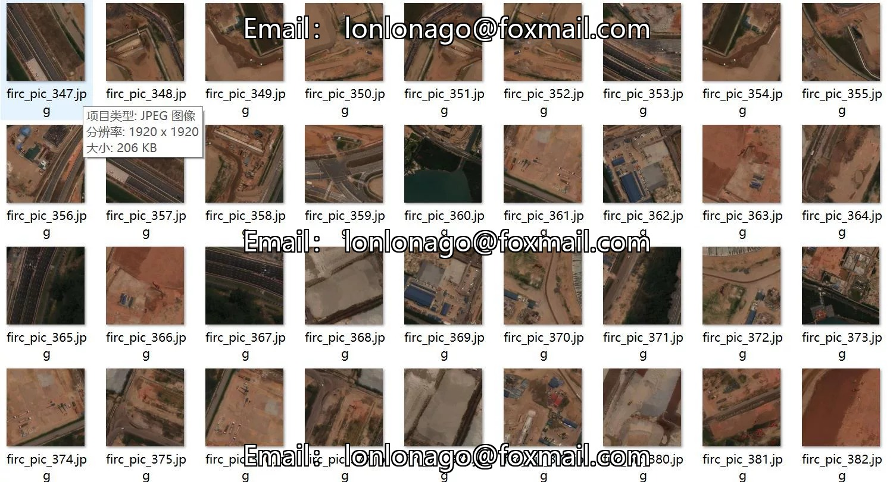
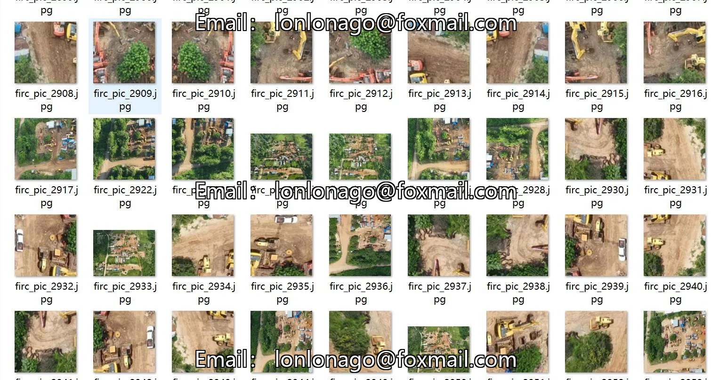
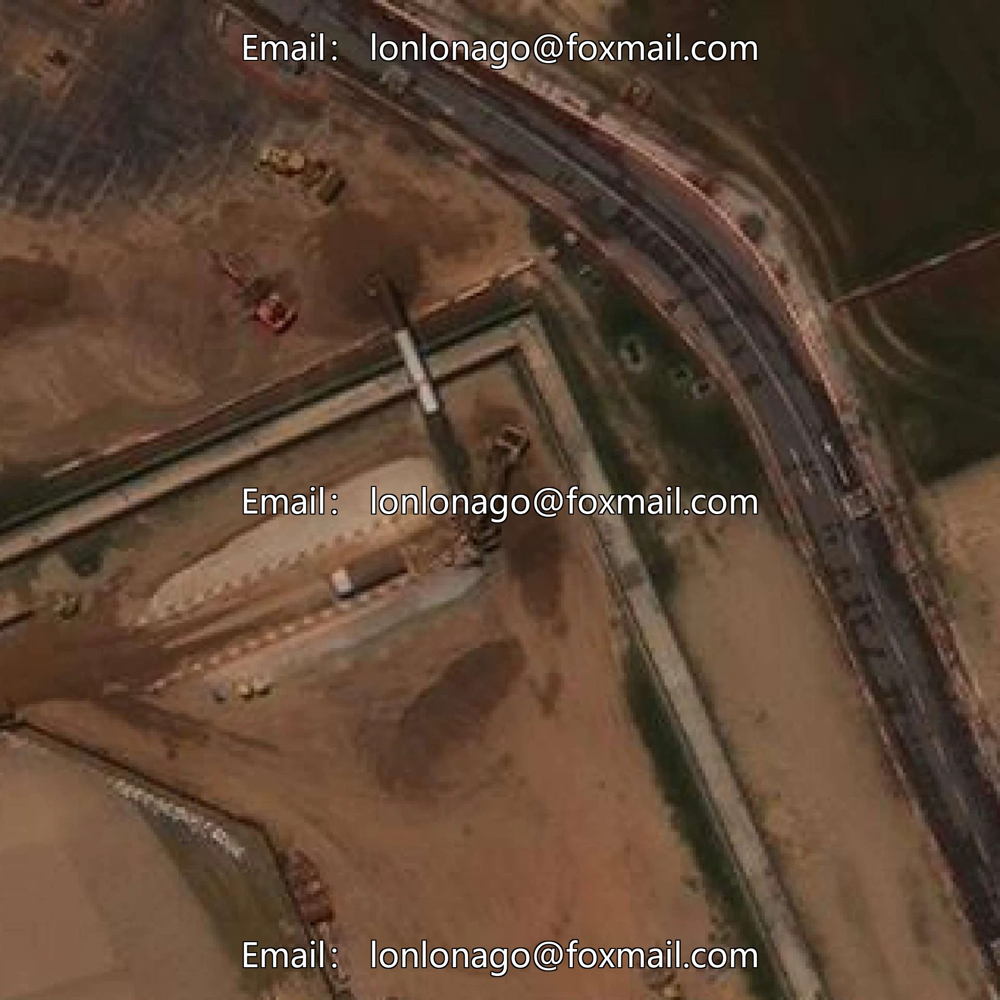
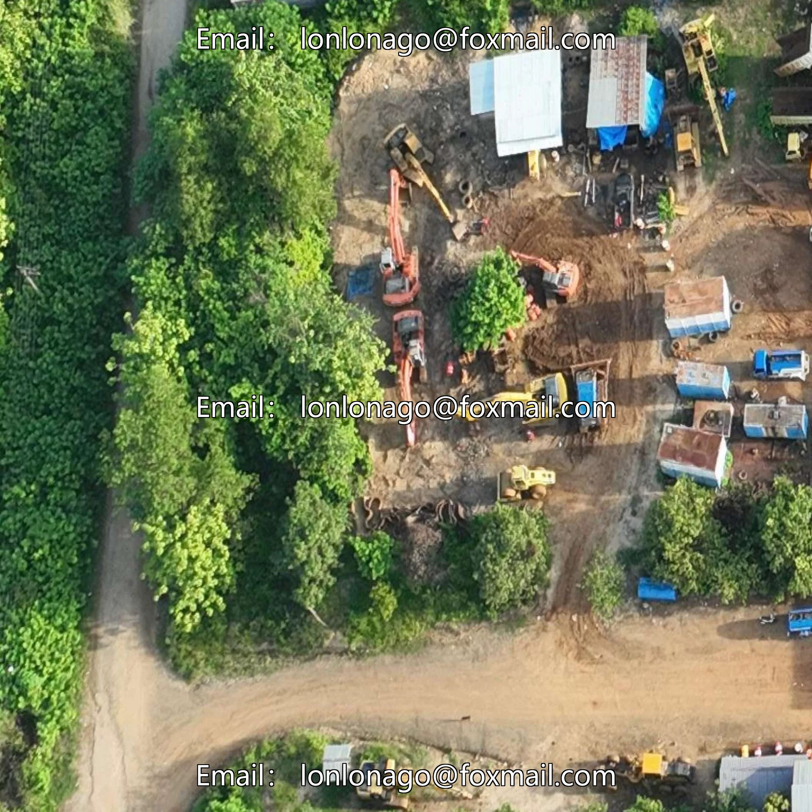
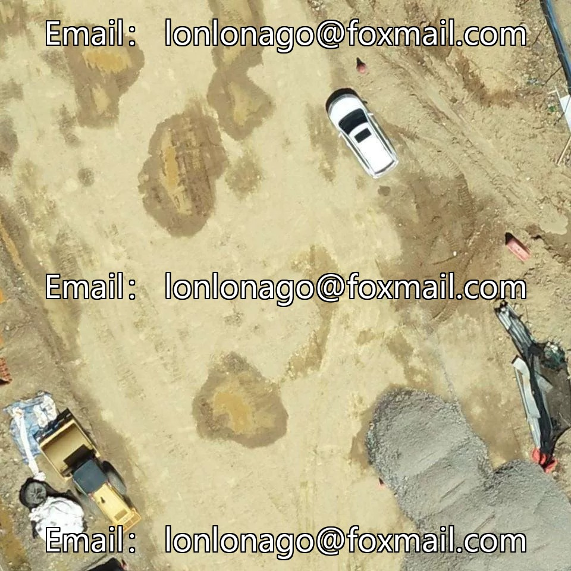

# Drone-view aerial photography dataset for engineering vehicle inspection in VOC+YOLO format with 3178 images

## Body

Drone-Viewpoint Aerial Photography Vehicle Inspection Dataset VOC+YOLO Format: 3178 Images in 14 Categories
Warm Reminder: Due to the dataset's replicability, please confirm compliance with requirements before purchasing.
Dataset Format: Pascal VOC format + YOLO format (txt file without split path, only containing jpg images and corresponding VOC format xml files and yolo format txt files)
Number of Images (Total jpg files): 3178
Number of Annotations (Total xml files): 3178
Number of Annotations (Total txt files): 3178
Number of Annotation Categories: 14

Label category names (Note that the order of labels in the YOLO format does not correspond to this, but is based on the classes.txt file in the labels folder): ["chanyunji", "duigaoji", "jizhuangxiangqizhongji", "kuayunche", "pingdiji", "posuiji", "shuinijiaobanji", "tashiqizhongji", "tuituji", "wajueji", "yaluji", "yidongshiqizhongji", "zixiekache", "zuanji"]

1. Bucket truck
Number of boxes and the number of images occupied by each category
chanyunji frame count = 53, occupying picture count = 53
Duigaoji frame count = 537, occupying image count = 375
Jizhuangxiangqizhongji frame count = 437, occupying image count = 106
Kuayunche box count = 340, occupying image count = 163

Pingdiji: Frames = 418, Pictures = 349
Posuiji: Frames = 3, Pictures = 1
Shuinijiaobanji: Frames = 470, Pictures = 143
Tashiqizhongji: Frames = 477, Pictures = 274
Tuituji: Frames = 416, Pictures = 309
Wajueji: Frames = 416, Pictures = 326
Yaluji: Frames = 478, Pictures = 402
Yidongshiqizhongji: Frames = 448, Pictures = 154
Zixiekache: Frames = 454, Pictures = 277

Zuanji Frames = 442, Pictures Count = 441
Total Frames: 5389
Image Resolution: 1920x1920
Labeling Tool: labelImg
Labeling Rules: Draw a rectangle around the category.
Important Notice: The dataset does not have separate training, validation, and test sets; you need to partition them yourself.
Special Remark: This dataset does not guarantee the accuracy of the trained models or weight files.

## Images

## Payment

Here is a pay link on Stripe ( https://buy.stripe.com/3cs8yP7sY87d0vu9AB ). Please contact me lonlonago@foxmail.com after funding $89, and I will send you a complete data files , thank you!

